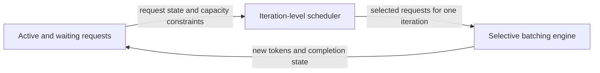
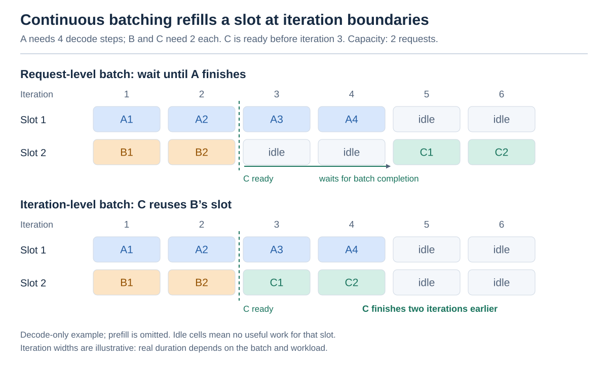
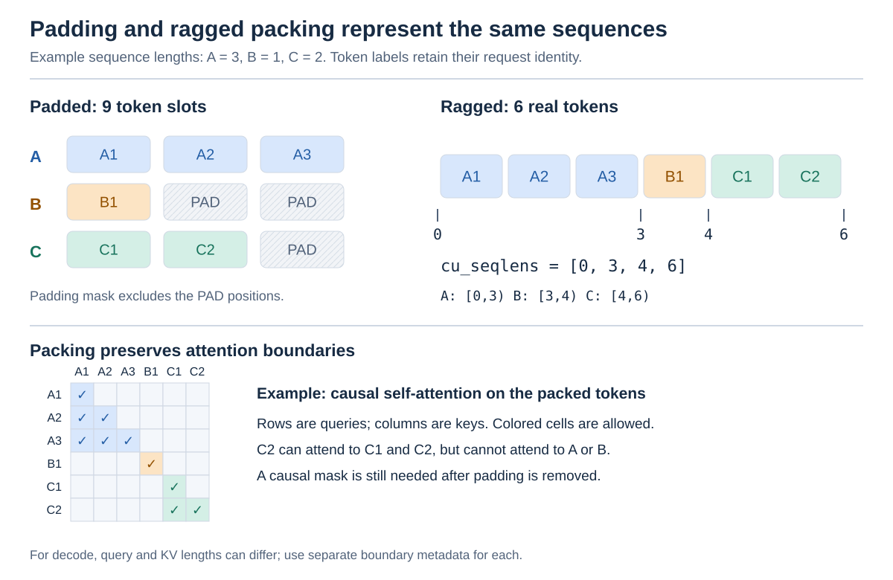
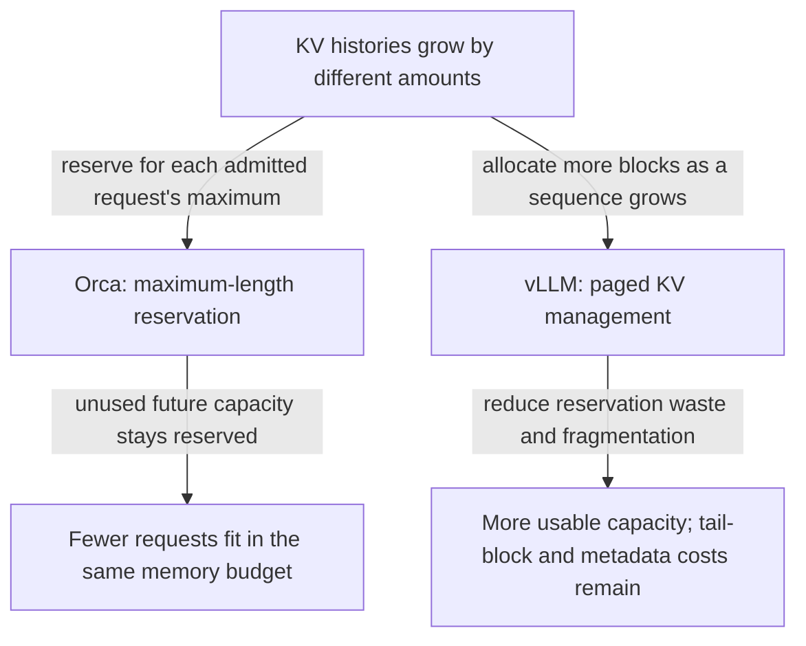
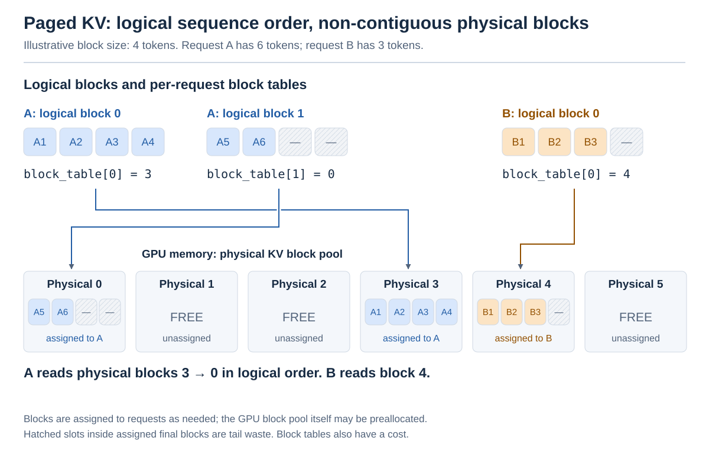
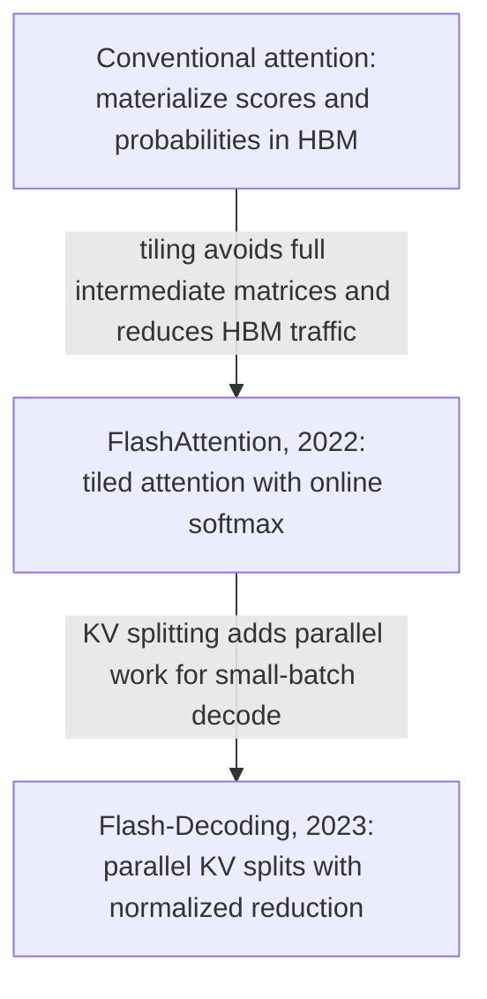
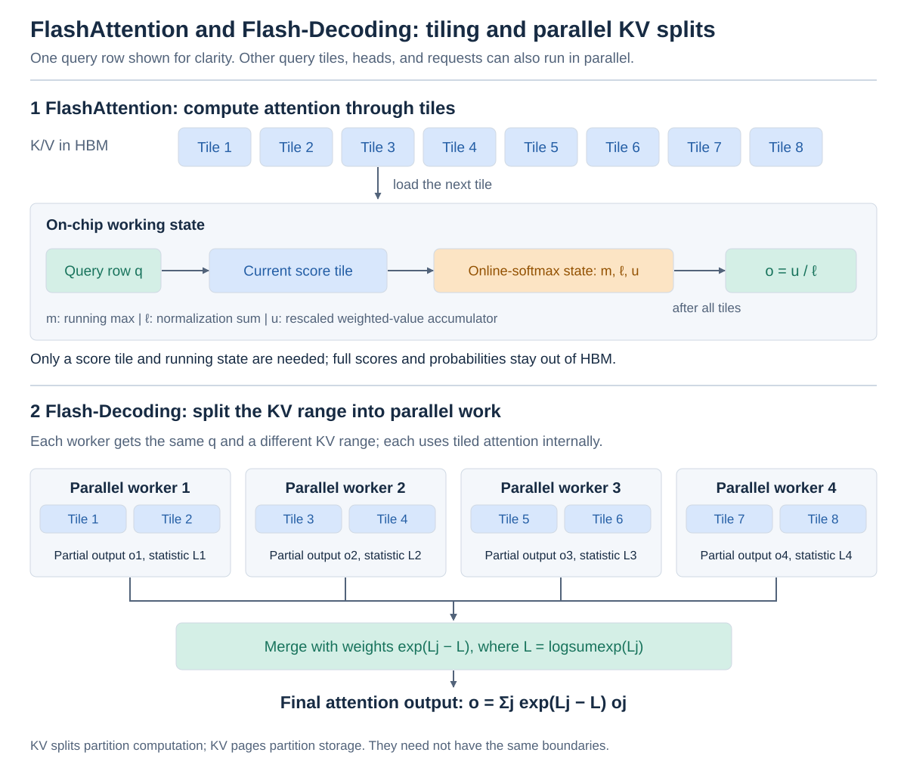

# AI Inference: Concepts and Techniques

Concise entries on autoregressive LLM inference, grouped into:

- Execution phases and state
- Request scheduling and operator batching
- KV-cache memory management
- Attention kernels

Related: [[knowledge/ai-infra/parallelism|Parallelism and state sharding]] covers DP, ZeRO, TP, and PP across training and inference.

## I. Execution Phases and Attention State

### 1. Prefill

Processes the prompt's tokens, builds their KV cache, and produces the logits used to sample the first output token. Parallel computation across prompt tokens often makes prefill compute-intensive; its duration contributes to time to first token (TTFT).

A large prefill can delay ongoing decode steps. Controlled mixing, such as chunked prefill under a token budget, can improve utilization. [Source: vLLM optimization guide](https://docs.vllm.ai/en/latest/configuration/optimization/#chunked-prefill).

Related paper: [[paper-vault/papers/yu2022orca|Orca]].

### 2. Decode

Processes one new token per active sequence per step, reuses its KV cache, and predicts the next token. This entry assumes ordinary decoding, without speculative decoding. Step duration affects inter-token latency (ITL).

Small-batch decode is often bandwidth-bound, spending much of its time moving model weights and KV data. The compute-bound prefill / bandwidth-bound decode distinction is a tendency: batch size, context length, model architecture, and hardware change the bottleneck. [Source: vLLM optimization guide](https://docs.vllm.ai/en/latest/configuration/optimization/#chunked-prefill).

Related paper: [[paper-vault/papers/yu2022orca|Orca]].

### 3. KV Cache

The **KV cache** stores previously computed key and value vectors for each attention layer, so later decode steps do not recompute the entire prefix. The current query attends to the cached keys and values plus the newly appended token's state. The cache saves computation but consumes memory that generally grows with sequence length. [Source: Transformers cache explanation](https://huggingface.co/docs/transformers/en/cache_explanation).

Related paper: [[paper-vault/papers/kwon2023pagedattention|PagedAttention]].

## II. Request Scheduling and Operator Batching

Orca introduced iteration-level scheduling and selective batching together: the former selects requests each round; the latter executes them. The arrows show runtime information flow. [Source: Orca](https://www.usenix.org/system/files/osdi22-yu.pdf).

### 1. Iteration-Level Scheduling / Continuous Batching

Orca schedules one model iteration at a time. At iteration boundaries, finished requests leave and waiting requests may enter, subject to batch and memory limits; arrivals do not interrupt an in-progress kernel. During ordinary decode, each selected sequence advances by one token. This removes the need to wait for the longest request before refilling a batch. **Continuous batching** is the common later name for this scheduling pattern. [Source: Orca](https://www.usenix.org/system/files/osdi22-yu.pdf).

*A shorter request frees a slot after iteration 2. Continuous batching lets C use that slot in iteration 3; a fixed batch waits for A to finish. This original schematic follows the scheduling mechanism in [Orca](https://www.usenix.org/system/files/osdi22-yu.pdf); equal-width iterations illustrate admission order, not measured latency, and prefill is omitted.*

Related paper: [[paper-vault/papers/yu2022orca|Orca: iteration-level scheduling]].

### 2. Selective Batching

Orca combines the current tokens from selected requests for token-wise operators, including QKV projections and feed-forward layers, while splitting attention into request-specific computations and merging their outputs afterward. Shared linear operators can consume a packed token matrix; attention must respect each sequence's own KV history. This execution strategy makes heterogeneous requests compatible with iteration-level scheduling. Modern varlen attention can batch those logically separate attention computations inside one kernel. [Source: Orca](https://www.usenix.org/system/files/osdi22-yu.pdf); [varlen attention API](https://docs.pytorch.org/docs/2.14/nn.attention.varlen.html).

The operator boundary in Orca is:

| Operator | Batched across requests? | Reason |
| --- | --- | --- |
| QKV Linear | Yes | Each token uses the same projection weights; inputs can be packed as `[sum(L_i), H]`. |
| Attention output Linear | Yes, after merging Attention outputs | The output projection acts independently on each token with shared weights. |
| MLP Linear layers and GeLU | Yes | These transformations act independently on each token. |
| LayerNorm | Yes | Normalization is over each token's hidden features, without mixing tokens from different requests. |
| Residual Add | Yes | Corresponding tensor elements are added independently. |
| Attention core: `QK^T`, scaling / causal masking, softmax, and multiplication by `V` | No; computed separately for each request | Each query uses its own request's keys and values, with potentially different history lengths. |

Here, **Attention** means the core attention computation, excluding QKV and output projections. The execution pattern is **batched QKV projection → split by request → per-request Attention → merge → batched output projection**. Batching combines token activations for each operator; it does not combine different operators into one operation or imply kernel fusion. Separate Attention computations also do not, by themselves, establish whether GPU execution overlaps. [Source: Orca, Section 3 and Figures 1b and 5](https://www.usenix.org/system/files/osdi22-yu.pdf).

Related paper: [[paper-vault/papers/yu2022orca|Orca: selective batching]].

### 3. Request Isolation

Each query may access only its own sequence's allowed context. Packing requests together must preserve this boundary; it does not require a separate kernel per request. Shared, identical prefixes may reuse physical KV storage without mixing unrelated histories.

Related papers: [[paper-vault/papers/vaswani2017attention|Transformer attention foundations]]; [[paper-vault/papers/kwon2023pagedattention|PagedAttention and KV sharing]].

### 4. Padding

Extends sequences to a common length so tensors have rectangular shapes. Lengths `[3, 1, 2]` become three rows of length 3: nine slots for six real tokens. A padding mask excludes added positions from attention, but masking alone does not guarantee that their computation or storage is skipped. [Source: PyTorch varlen tutorial](https://docs.pytorch.org/tutorials/intermediate/variable_length_attention_tutorial.html).

### 5. Ragged / Packed Batching

Packs real tokens without padding and records sequence boundaries with cumulative offsets, often named `cu_seqlens` or `indptr`. Lengths `[3, 1, 2]` use six token slots and offsets `[0, 3, 4, 6]`; request `i` occupies `[offsets[i], offsets[i + 1])`.

Variable-length (varlen) attention kernels use this metadata to batch separate sequences' attention. Query and KV offsets can differ: decode may have one query per request but many cached keys. Causal or other attention constraints still apply. [Sources: PyTorch varlen tutorial](https://docs.pytorch.org/tutorials/intermediate/variable_length_attention_tutorial.html); [FlashInfer KV layouts](https://docs.flashinfer.ai/tutorials/kv_layout.html).

*The same six tokens occupy nine padded slots or six packed slots. The lower matrix makes the attention boundary explicit: packing C next to B does not let C attend to B. This original example follows the [PyTorch varlen tutorial](https://docs.pytorch.org/tutorials/intermediate/variable_length_attention_tutorial.html) and [FlashInfer's layout documentation](https://docs.flashinfer.ai/tutorials/kv_layout.html). The mask shows allowed positions; a kernel need not materialize this dense matrix.*

### 6. Attention Mask

Defines which key positions a query may attend to. A **padding mask** excludes artificial padding; a **causal mask** excludes future positions within a sequence. Packed sequences also require request boundaries: a single causal triangle over the entire packed array would allow later requests to see earlier ones. Kernels can enforce these constraints through metadata without materializing a dense mask. [Sources: Transformer attention](https://arxiv.org/abs/1706.03762); [PyTorch varlen tutorial](https://docs.pytorch.org/tutorials/intermediate/variable_length_attention_tutorial.html).

Related paper: [[paper-vault/papers/vaswani2017attention|Transformer]].

## III. KV-Cache Memory Management

Orca reserves each request's maximum KV capacity; vLLM assigns blocks as needed. This allocation change complements iteration-level scheduling. The diagram compares their memory costs. [Sources: Orca](https://www.usenix.org/system/files/osdi22-yu.pdf); [PagedAttention](https://arxiv.org/abs/2309.06180).

### 1. PagedAttention

**PagedAttention** allows attention kernels to read a sequence's logical KV history from non-contiguous physical blocks using a block table. The vLLM runtime allocates and reclaims fixed-size blocks as sequences grow and finish, and can share blocks for common prefixes with copy-on-write where needed. The kernel and runtime cooperate: paging is more than an allocation policy.

Compared with Orca's maximum-length reservation, this avoids reserving the full eventual cache for every admitted request and greatly reduces fragmentation and duplicated state. Waste is not literally zero: partially filled final blocks, metadata, and management overhead remain. Ragged batching describes sequence boundaries; paging describes physical KV placement. A kernel can consume ragged queries and paged KV together. [Sources: PagedAttention paper](https://arxiv.org/abs/2309.06180); [FlashInfer KV layouts](https://docs.flashinfer.ai/tutorials/kv_layout.html).

*A's logical blocks map to physical blocks 3 and 0, so sequence order is independent of physical placement. Unassigned blocks remain available to the allocator, while unused slots inside the last assigned block are tail waste. This original schematic illustrates the logical-to-physical mapping in [PagedAttention](https://arxiv.org/abs/2309.06180), using a toy block size of four tokens. Each token slot represents its K and V state; the engine may preallocate the overall GPU pool while assigning blocks to requests on demand.*

Related papers: [[paper-vault/papers/kwon2023pagedattention|PagedAttention]]; [[paper-vault/papers/yu2022orca|Orca's reservation baseline]].

## IV. Attention Kernel Optimization

Here, “Flash” is part of the technique names, suggesting speed; it does not refer to flash memory or a standalone algorithmic step.

- **FlashAttention:** Uses tiling and online softmax to reduce attention's intermediate memory traffic.
- **Flash-Decoding:** Extends this approach for decode with parallel KV splits and a final weighted reduction.

The arrows below identify mechanisms and bottlenecks, with workload-dependent benefits. [Sources: FlashAttention](https://arxiv.org/pdf/2205.14135); [Flash-Decoding](https://crfm.stanford.edu/2023/10/12/flashdecoding.html).

### 1. FlashAttention

**Core idea: Compute attention in fast on-chip memory to reduce HBM reads and writes.**

Computes exact attention using tiling and online softmax, avoiding full attention score and probability matrices in high-bandwidth memory (HBM).

The gain comes from reducing memory traffic and intermediate storage, not from dropping attention entries. Dense attention still has quadratic arithmetic cost in sequence length; floating-point rounding can differ from a conventional implementation. This is complementary to paged KV storage, provided the chosen kernel supports that layout. [Source: FlashAttention paper, Section 3](https://arxiv.org/pdf/2205.14135).

Paper: [FlashAttention (Dao et al., 2022)](https://arxiv.org/abs/2205.14135). Background: [[paper-vault/papers/vaswani2017attention|Transformer attention]].

### 2. Tiling

**Core idea: Divide Q/K/V computation into tiles that fit in shared memory and registers.**

Divides computation into blocks sized for fast on-chip memory. FlashAttention loads Q, K, and V tiles, computes partial attention, and accumulates the output without writing the full intermediate matrices to HBM. [Source: FlashAttention, Section 3](https://arxiv.org/pdf/2205.14135).

### 3. Online Softmax

**Core idea: Update softmax normalization block by block without storing all scores.**

Computes softmax incrementally over blocks, maintaining a running maximum and normalization sum. In attention, an output accumulator is updated alongside them; when the maximum changes, earlier contributions are rescaled. This lets tiled attention remain correctly normalized without retaining every score. [Source: FlashAttention, Section 3](https://arxiv.org/pdf/2205.14135).

### 4. Split-KV

**Core idea: Split one sequence's KV history across parallel thread blocks on the same GPU.**

Partitions the KV sequence dimension so multiple GPU thread blocks compute partial attention for the same query in parallel. This helps when long KV histories and insufficient existing parallelism leave GPU streaming multiprocessors (SMs) underused. Reduction and temporary-storage overhead can outweigh the benefit on short contexts or already well-utilized batches. Computational splits are independent of physical KV-cache pages. [Source: Flash-Decoding author explanation](https://crfm.stanford.edu/2023/10/12/flashdecoding.html).

### 5. Flash-Decoding

**Core idea: Accelerate decode attention with Split-KV, FlashAttention-style computation, and a weighted merge.**

Applies Split-KV with FlashAttention-style computation inside each split, then merges partial outputs using their log-sum-exp statistics. It targets small-batch decode, where the short query length exposes too little parallel work. [Source: Flash-Decoding author explanation](https://crfm.stanford.edu/2023/10/12/flashdecoding.html).

*The upper panel shows tiled computation for one query row with running softmax state. The lower panel distributes that row's KV range across parallel workers, each retaining the tiled computation internally. This original schematic follows [FlashAttention](https://arxiv.org/pdf/2205.14135) and the authors' [Flash-Decoding explanation](https://crfm.stanford.edu/2023/10/12/flashdecoding.html). Workers represent GPU thread blocks, not necessarily separate GPUs; computational splits and physical cache pages are different units.*

For one query row, let split `j` return a normalized output `o_j` and `L_j = log(sum(exp(scores_j)))`. The merged output is:

$$
L = \operatorname{logsumexp}_j L_j,
\qquad
o = \sum_j \exp(L_j - L)\,o_j.
$$

The partial outputs must be weighted by their normalization statistics, rather than simply averaged. [Source: Flash-Decoding author explanation](https://crfm.stanford.edu/2023/10/12/flashdecoding.html).
