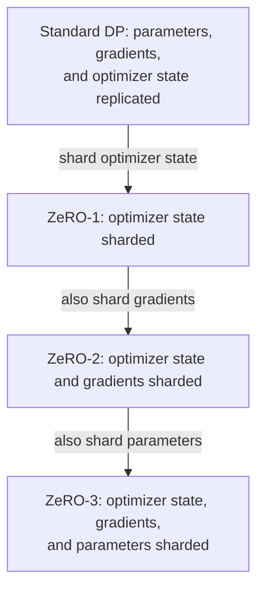
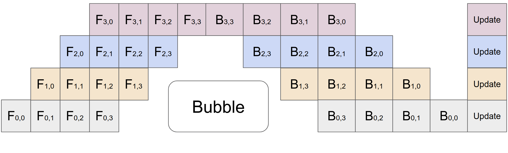

# Parallelism and State Sharding

Concise entries covering training and inference:

- Data parallelism and state sharding
- Model parallelism
- Pipeline execution

For each technique, distinguish what is replicated or split, the benefit, and the cost. Related: [[knowledge/ai-infra/inference|Inference concepts and techniques]].

Training foundations: [[knowledge/ai-infra/training#1. Parameters|parameters]], [[knowledge/ai-infra/training#2. Gradients|gradients]], and [[knowledge/ai-infra/training#3. Optimizer State|optimizer state and memory accounting]].

## I. Data Parallelism and State Sharding

ZeRO removes state replication within a data-parallel group. The arrows below show cumulative sharding stages, not successive computation steps. “Replicated” refers to model state within that group; TP and PP can separately partition the model.



### 1. Data Parallelism (DP)

**Core idea: Replicate the model and process different data on each replica.**

In standard synchronous training, replicas compute gradients on different samples and synchronize them before updating identical weights. The benefit is higher aggregate throughput; the costs are replicated model state, gradient communication, and waiting for slower replicas. DP alone does not reduce the parameter memory required by each replica. [Source: PyTorch DDP tutorial](https://docs.pytorch.org/tutorials/intermediate/ddp_tutorial.html).

In ordinary dense-model inference, replicas serve different requests without gradient synchronization. This increases serving capacity, rather than dividing one request's computation among replicas. Each replica can itself span a TP/PP group. [Source: vLLM data parallel deployment](https://docs.vllm.ai/en/latest/serving/data_parallel_deployment/).

### 2. ZeRO

**Core idea: Save memory by distributing redundant training state across data-parallel workers.**

ZeRO (Zero Redundancy Optimizer) progressively shards [[knowledge/ai-infra/training#3. Optimizer State|optimizer state]], [[knowledge/ai-infra/training#2. Gradients|gradients]], and [[knowledge/ai-infra/training#1. Parameters|parameters]]. Workers still process different samples; state ownership and communication change. Its main benefit is lower per-device model-state memory, rather than eliminating computation or pipeline bubbles. Activation memory and temporary buffers remain. [Paper: ZeRO](https://arxiv.org/abs/1910.02054).

Ordinary inference has no gradients or optimizer state, so the three training stages do not transfer unchanged. ZeRO-Inference instead includes weight offloading and layer prefetching, trading GPU residency for data movement from CPU/NVMe. [Source: ZeRO-Inference](https://www.deepspeed.ai/2022/09/09/zero-inference.html).

### 3. ZeRO-1

**Core idea: Shard optimizer state while retaining replicated parameters and gradients.**

Each worker updates its owned parameter partition, with updated weights communicated to maintain replicas. This saves [[knowledge/ai-infra/training#3. Optimizer State|optimizer-state memory]], including Adam moments and, in mixed-precision setups, master weights. It changes communication organization but need not increase total communication volume over standard DP in the paper's analysis. [Paper: ZeRO](https://arxiv.org/abs/1910.02054).

### 4. ZeRO-2

**Core idea: Also shard the reduced gradients used for parameter updates.**

Workers retain the reduced [[knowledge/ai-infra/training#2. Gradients|gradients]] corresponding to their optimizer-state partitions; parameters remain replicated. Gradient reduction and distribution, commonly via reduce-scatter, save gradient storage. Reduction buffers still occupy memory, and synchronization remains necessary. [Source: DeepSpeed ZeRO documentation](https://deepspeed.readthedocs.io/en/latest/zero3.html).

### 5. ZeRO-3

**Core idea: Also shard parameters, gathering them when computation needs them.**

[[knowledge/ai-infra/training#1. Parameters|Parameters]] are gathered for the relevant computation and can then be released back to shards. This further reduces persistent model-state memory, at the cost of parameter gathering during forward/backward and temporary materialization buffers. Prefetching and retention policies trade memory for communication. Unlike TP, sharded storage does not mean each worker only computes its own weight slice on the same input. [Source: DeepSpeed ZeRO documentation](https://deepspeed.readthedocs.io/en/latest/zero3.html).

## II. Model Parallelism

TP partitions computation within layers; PP partitions the sequence of layers. Both support training and inference, and can be combined with DP and state sharding. [Sources: Megatron-LM](https://arxiv.org/abs/2104.04473); [vLLM parallelism guide](https://docs.vllm.ai/en/latest/serving/parallelism_scaling/).

### 1. Tensor Parallelism (TP)

**Core idea: Split a layer's tensors and computation across devices working on the same input.**

For example, partition a linear layer's weight matrix by output columns: each device computes a subset of output features. Subsequent operations may keep those features sharded, gather them, or reduce partial results, depending on the partitioning scheme. [Paper: Megatron-LM](https://arxiv.org/abs/1909.08053).

TP lowers per-device parameter storage and divides large operations. The cost is frequent inter-device communication; smaller local operations and synchronization can limit speedup. Training includes backward communication; inference retains forward communication, whose latency can be significant during small-batch decode. [Sources: Megatron-LM](https://arxiv.org/abs/2104.04473); [vLLM parallelism guide](https://docs.vllm.ai/en/latest/serving/parallelism_scaling/).

### 2. Pipeline Parallelism (PP)

**Core idea: Place different layer groups on different devices and overlap work from multiple microbatches.**

A microbatch passes through stages in layer order; different stages can process different microbatches simultaneously. Training also sends activation gradients backward. This distributes layer storage and computation, but adds boundary communication, stage imbalance, and pipeline bubbles. PP does not automatically reduce bubbles; its execution schedule determines idle time. [Papers: GPipe](https://arxiv.org/abs/1811.06965); [Megatron-LM](https://arxiv.org/abs/2104.04473).



*Reproduced from Huang et al., [GPipe, Figure 2(c)](https://arxiv.org/html/1811.06965v5#S2.F2) ([original image](https://arxiv.org/html/1811.06965v5/PipelineParallelism.png)). Time runs left to right; rows are stages 0–3 from bottom to top. `F` and `B` denote forward and backward computation, with subscripts `(stage, microbatch)`. Blank regions are idle bubbles; the final updates follow gradient accumulation over all microbatches. This illustrates GPipe's forward-then-backward training schedule, not every possible PP schedule.*

**Reading the labels:** `F_{1,0}` means the forward computation of microbatch 0 at stage 1; `B_{1,0}` means its backward computation at that stage. Both indices start at 0. A stage holds a group of consecutive layers, not a single layer: stage 0 contains the earliest layers, followed by stages 1, 2, and 3. For example, a 24-layer model could assign layers 1–6, 7–12, 13–18, and 19–24 to the four stages; actual partitions need not be equal. For microbatch 0, forward computation follows `F_{0,0} → F_{1,0} → F_{2,0} → F_{3,0}`, and backward follows `B_{3,0} → B_{2,0} → B_{1,0} → B_{0,0}`.

Inference uses forward stages only. A single ordinary decode sequence must finish a model pass and select its next token before starting the next pass; other requests can provide work to overlap across stages. An example of inference pipeline execution is [[paper-vault/papers/yu2022orca|Orca]], Section 4.2.

## III. Pipeline Execution

This illustrative forward timeline uses three equal-speed stages and three independent microbatches, A/B/C. Each column is one time slot; `--` means idle. A microbatch moves down one stage in the next slot, while different microbatches overlap.

```text
Time slot       1    2    3    4    5
Stage 1         A    B    C   --   --
Stage 2        --    A    B    C   --
Stage 3        --   --    A    B    C
```

*Original schematic based on [GPipe](https://arxiv.org/abs/1811.06965). It omits communication time and training's backward pass; it is not a complete training schedule. At slot 3 all stages are busy, whereas pipeline filling and draining leave idle slots.*

### 1. Microbatch

**Core idea: Split a batch into smaller work units that can occupy different pipeline stages.**

In synchronous pipeline training, [[knowledge/ai-infra/training#4. Gradient Accumulation|gradient accumulation]] combines gradients from multiple microbatches before an optimizer update; the linked entry explains effective batch size and normalization. More microbatches can reduce the relative fill/drain overhead, but smaller microbatches may make kernels less efficient. In inference, microbatches carry requests through forward stages without gradient accumulation. [Sources: GPipe](https://arxiv.org/abs/1811.06965); [Megatron-LM](https://arxiv.org/abs/2104.04473).

### 2. Pipeline Bubble

**Core idea: A pipeline stage is idle because its scheduled work is not yet ready or has run out.**

Filling and draining the pipeline, dependencies, and unequal stage times reduce utilization. In the idealized forward timeline above, `p` equal-duration stages and `m` microbatches take `m + p - 1` slots, giving idle fraction `(p - 1) / (m + p - 1)`: here, `2/5`. This is an illustrative calculation, not a universal training or serving formula.

More microbatches, balanced partitions, and improved schedules can reduce bubbles, with trade-offs in kernel efficiency, activation storage, and communication. Training schedules must also account for backward work; inference depends on enough independent requests to keep stages occupied. [Sources: GPipe](https://arxiv.org/abs/1811.06965); [Megatron-LM](https://arxiv.org/abs/2104.04473); [[paper-vault/papers/yu2022orca|Orca]].
